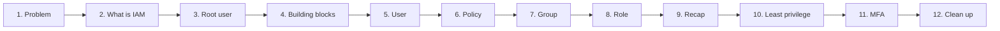
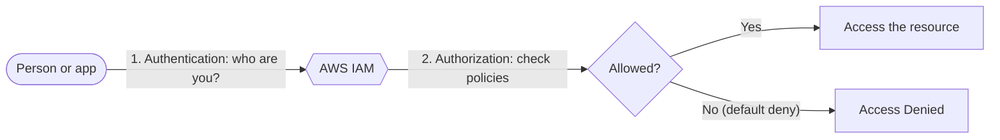
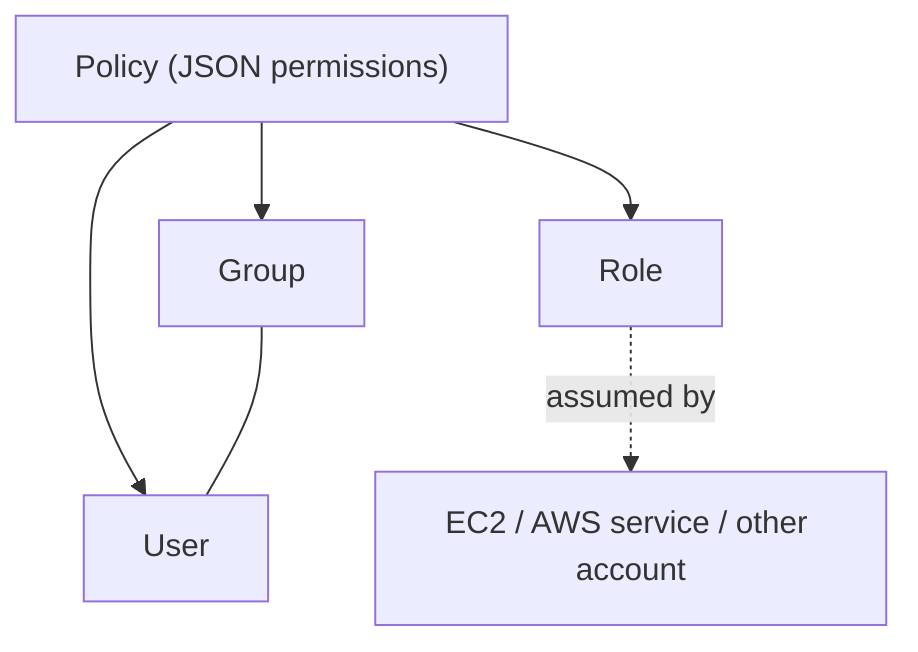
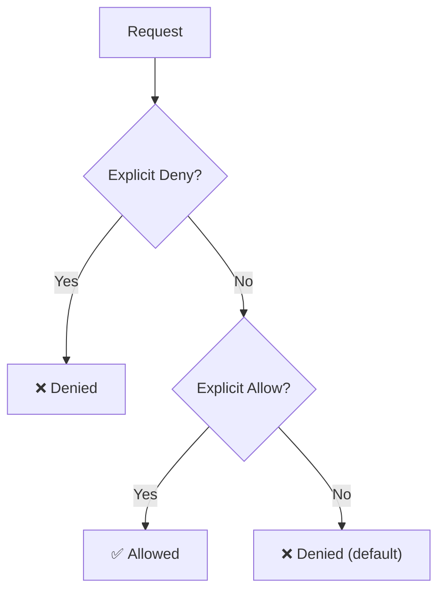
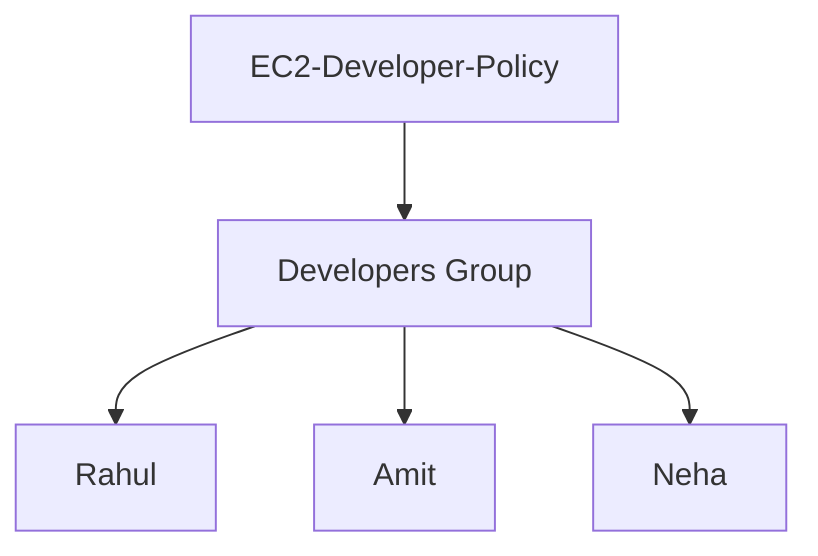
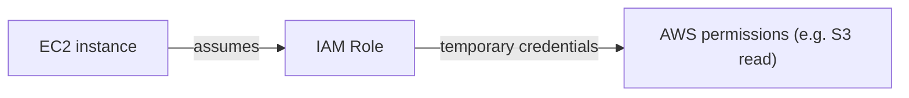
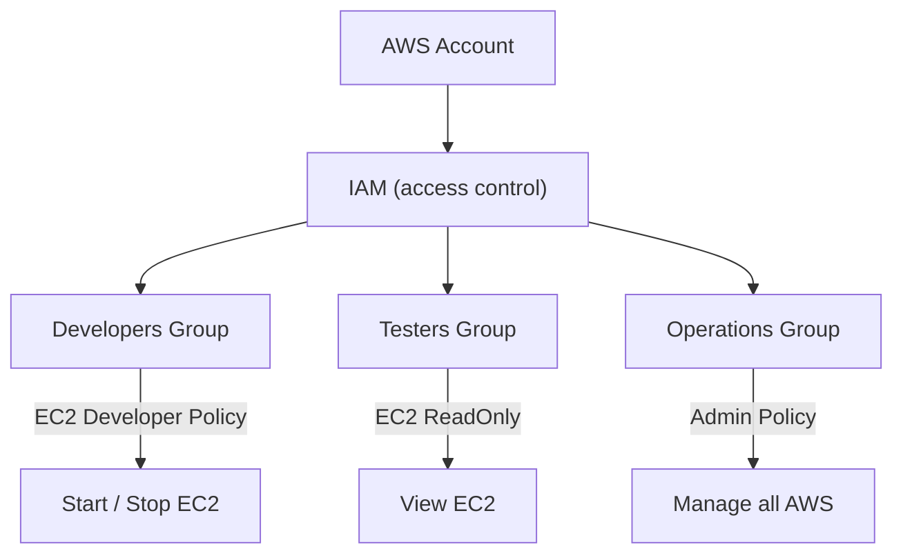
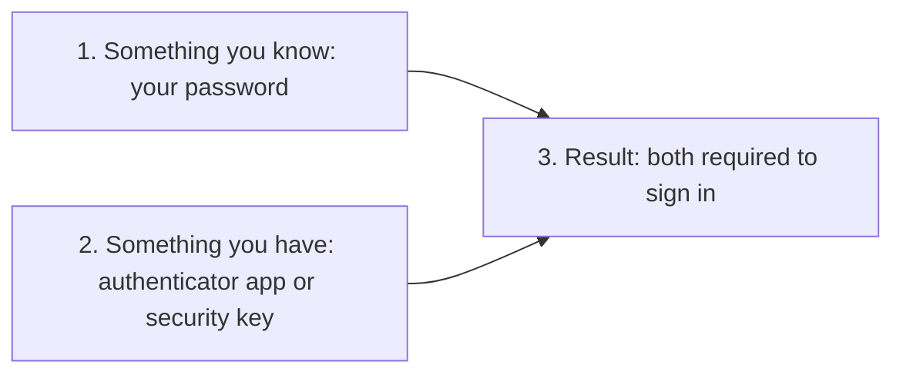

<p align="center"></p>

<h1 align="center">AWS IAM — Identity and Access Management</h1>
<p align="center"><b>Step-by-step course notes with labs</b><br/>
 Users &nbsp;|&nbsp;  Policies &nbsp;|&nbsp;  Groups &nbsp;|&nbsp;  Roles &nbsp;|&nbsp;  Best practices</p>

---

## 🗺️ Course Roadmap

Follow the modules in order. Each one has the same pattern: **Learn → Understand → Do (lab) → Check yourself**.



| Module | Topic | Icon | Lab |
|---|---|---|---|
| [1](#module-1) | The access-control problem |  | – |
| [2](#module-2) | What is IAM (authentication vs authorization) |  | – |
| [3](#module-3) | The root user and why we avoid it |  | – |
| [4](#module-4) | The 4 building blocks |  | – |
| [5](#module-5) | IAM User |  | Lab 1 |
| [6](#module-6) | IAM Policy |  | Lab 2, 2b |
| [7](#module-7) | IAM Group |  | Lab 3 |
| [8](#module-8) | IAM Role |  | Lab 4 |
| [9](#module-9) | Recap and real company example |  | – |
| [10](#module-10) | Least privilege |  | Lab 5 |
| [11](#module-11) | MFA |  | Lab 6 |
| [12](#module-12) | Clean up, interview prep, summary |  | Lab 7 |

### 🎯 What you will be able to do

- Explain what IAM is, and the difference between authentication and authorization
- Tell apart a user, group, policy and role
- Read and write a basic IAM policy in JSON
- Create a user, group and role, and attach permissions
- Apply least privilege and protect accounts with MFA
- Explain why the root user is not used for daily work

> [!NOTE]
> **Prerequisites:** an AWS account (free tier is enough). IAM itself is free. Only running EC2 instances cost money.

---

<a name="module-1"></a>
##  Module 1: The Problem

**Learn:** why we need access control at all.

### Scenario

> A company has **10 employees**.
> - **Developers** must access **EC2**, but must not delete production resources.
> - The **Finance** team must access **billing**, but not EC2.
>
> **How can AWS control this?**

**Answer: IAM.** Look at what the finished design does:


### Notes

| Team | Needs | Policy allows | Policy blocks |
|---|---|---|---|
|  Developers (5) | Use EC2, no deleting | `ec2:DescribeInstances`, `ec2:StartInstances`, `ec2:StopInstances` | `ec2:Delete*`, billing |
|  Finance (5) | Use billing, no EC2 | `billing:*` | `ec2:*` |

> [!IMPORTANT]
> The pattern to remember: **group of people → policy → what they can and cannot do.**

**✅ Check yourself**

<details><summary>Why can't everyone just share one login?</summary>
A shared login has no accountability (you cannot tell who did what), no limits, and one leaked password exposes everything.
</details>

---

<a name="module-2"></a>
##  Module 2: What is IAM?

**Learn:** the definition, and the two ideas inside it.

**IAM** (Identity and Access Management) is the AWS service that controls **who can sign in** and **what they can do once inside**. It manages users, groups, roles and permissions so that the right person gets the right access to the right resources.

```
IAM = Authentication + Authorization
```

| |  Authentication |  Authorization |
|---|---|---|
| **Question** | Who are you? | What are you allowed to do? |
| **How** | Password, access key or MFA code | Permissions written in policies |
| **Happens** | First | Second |

> [!TIP]
> **Airport analogy:** passport check = authentication (who are you). Boarding pass = authorization (which flight can you board).



### Why do we need IAM?

| # | Reason | Meaning |
|---|---|---|
| 1 | **Security** | Protect the account from misuse and mistakes |
| 2 | **Least privilege** | Give only the access a job needs |
| 3 | **Individual access** | One login per person, never shared |
| 4 | **Role-based access** | Permissions follow the job role |
| 5 | **Avoid root** | Root has unlimited power, so lock it away |
| 6 | **Audit** |  CloudTrail records who did what |

> [!NOTE]
> IAM is **free** and **global** (not tied to one region).

**✅ Check yourself**

<details><summary>Logging in with a password: authentication or authorization?</summary>
Authentication. Authorization is what the policies then allow you to do.
</details>

---

<a name="module-3"></a>
##  Module 3: The Root User

**Learn:** what root is and why it is dangerous.

The **root user** is the identity created when the AWS account is first opened. It has **unlimited power** over everything in the account and cannot be restricted.

> [!WARNING]
> **Never use the root user for daily work.** A leaked root password or key exposes the entire account.

**Root user rules**

-  Enable MFA on root
-  Delete root access keys
- Use root **only** for the few tasks that truly require it
- Do daily work with a normal IAM user

---

<a name="module-4"></a>
##  Module 4: The 4 Building Blocks

**Learn:** the four words that the rest of the course is built on.

| | Component | What it is | Analogy |
|---|---|---|---|
|  | **User** | One person or application identity | A named employee badge |
|  | **Group** | A team of users sharing permissions | A department |
|  | **Policy** | A JSON document listing allowed or denied actions | A permission letter |
|  | **Role** | Temporary permissions that can be assumed | A visitor pass |

> [!IMPORTANT]
> Policies are attached to **Users, Groups or Roles**. The policy holds the permissions; the other three receive them.



Next we study each block in detail: user, policy, group, role.

---

<a name="module-5"></a>
##  Module 5: IAM User = One Identity

**Learn:** an IAM user represents **one person or application**. It has its own name and credentials, separate from root.

> [!NOTE]
> A new user has **no permissions at all** until you attach a policy.

### Three ways a user proves identity

| # | Method | Used for |
|---|---|---|
| 1 |  **Console password** | People signing in to the web console |
| 2 |  **Access keys** | CLI, SDK or API calls. Keep them secret |
| 3 |  **MFA device** | A second proof, such as an authenticator app |

| Person | Job | IAM user |
|---|---|---|
| Prashant | Developer | `dev-user` |
| Riya | Tester | `test-user` |
| Parimal | Admin | `admin-user` |

###  Lab 1: Create an IAM User

**Goal:** create `dev-user` and confirm it has **no permissions** by default.

| Step | Action | Details |
|---|---|---|
| 1 | Open IAM | AWS Console > search *IAM* > Users |
| 2 | Create user | Click *Create user*, name it `dev-user` |
| 3 | Enable console access | Tick console access, set a custom password |
| 4 | Skip permissions for now | Choose *Attach policies directly*, select none, then *Create user* |
| 5 | Sign in and observe | Use the account sign-in URL, open EC2 |

✅ **Expected result:** signed in as `dev-user`, the EC2 page shows *"You are not authorized"* messages. Everything is denied.

> [!TIP]
> Use a private browser window so you stay signed in as admin elsewhere.

**✅ Check yourself**

<details><summary>You just created a user. What can it do?</summary>
Nothing. IAM is default-deny until a policy is attached.
</details>

---

<a name="module-6"></a>
##  Module 6: IAM Policy = Permission Letter

### Step 6.1: What is a policy?

A policy is a **JSON document** that states what an identity may do, and on which resources.

> [!IMPORTANT]
> Everything is **denied** unless a policy explicitly **allows** it.

**Example: EC2 read-only policy**

```json
{
  "Version": "2012-10-17",
  "Statement": [
    {
      "Effect": "Allow",
      "Action": [
        "ec2:DescribeInstances"
      ],
      "Resource": "*"
    }
  ]
}
```

- ✅ **Allowed:** Describe (view) EC2 instances
- ❌ **Denied:** Start, stop or terminate EC2

### Step 6.2: Read it line by line

| Field | Meaning |
|---|---|
| `Version` | Policy language version. Always use `2012-10-17` |
| `Statement` | The list holding the actual permission rules |
| `Effect` | `Allow` or `Deny`: what AWS does with the request |
| `Action` | The operation. `DescribeInstances` = view EC2 details |
| `Resource` | What it applies to. `*` means all resources |

> **Read it as:** Allow → view EC2 → on all EC2 resources.

### Step 6.3: The 5 key elements

| # | Element | Question | Example |
|---|---|---|---|
| 1 | **Effect** | Allow or Deny? | `Allow` |
| 2 | **Action** | Which operation? | `ec2:StartInstances` |
| 3 | **Resource** | On which AWS resource? | `arn:aws:ec2:...` |
| 4 | **Principal** | Who gets the access? | Used in role trust policies |
| 5 | **Condition** | Only when...? | Only from my IP |

> [!TIP]
> **Beginner tip:** start with Effect + Action + Resource. Learn Principal and Condition later.

### Step 6.4: How AWS decides



> [!IMPORTANT]
> **Evaluation rule:** default is deny. An **explicit Deny always beats any Allow**.

### Step 6.5: Three kinds of policies

| | AWS managed | Customer managed | Inline |
|---|---|---|---|
| **Who writes it** | Created and updated by AWS | Written by you, reusable | Embedded in one user, group or role |
| **Example** | `AmazonEC2ReadOnlyAccess` | `EC2-ReadOnly-Policy` | Deleted when the identity is deleted |
| **Best for** | Learning and common jobs | Production, least privilege | Rare one-off exceptions |

> [!TIP]
> Prefer **customer managed** policies: reusable and easy to audit.

###  Lab 2: Create and Attach a Policy

**Goal:** give `dev-user` permission to **view EC2 instances only**.

| Step | Action | Details |
|---|---|---|
| 1 | Open Policies | IAM > Policies > Create policy |
| 2 | Pick the service | Select  EC2, then tick the action `DescribeInstances` |
| 3 | Set the resource | Choose *All resources*, then open the JSON tab to compare |
| 4 | Name the policy | `EC2-ReadOnly-Policy`, then *Create policy* |
| 5 | Attach it | Users > `dev-user` > Add permissions > attach `EC2-ReadOnly-Policy` |

✅ **Expected result:** `dev-user` now lists EC2 instances in the console.

> [!NOTE]
> The EC2 console also calls other Describe actions. Some panels may still show errors. That is expected.

###  Lab 2b: Test the Permission

Sign in as `dev-user`, open EC2 > Instances, try **View**, then try **Stop**.

| Action | Result | Why |
|---|---|---|
| View instances | ✅ **SUCCESS** | `DescribeInstances` is allowed |
| Stop an instance | ❌ **ACCESS DENIED** | `StopInstances` is not allowed |

> **Default is deny:** if no policy allows an action, it is blocked.

**✅ Check yourself**

<details><summary>In a policy, what does <code>"Resource": "*"</code> mean?</summary>
The rule applies to all resources.
</details>

<details><summary>One policy says Allow, another says Deny for the same action. Result?</summary>
Denied. An explicit Deny always wins.
</details>

---

<a name="module-7"></a>
##  Module 7: IAM Group = A Team of Users

**Learn:** instead of giving permissions to each user, give them to a group.



### Why groups?

- 50 developers need the same access? Add them to **one group** instead of configuring 50 users.
- Change the policy **once** and everyone is updated.

### Rules

| Rule | Meaning |
|---|---|
| Inheritance | Every user in the group gets its permissions |
| Many groups | A user can belong to many groups |
| No nesting | Groups cannot contain other groups |

###  Lab 3: Create a Group

**Goal:** manage two developers through one `Developers` group.

| Step | Action | Details |
|---|---|---|
| 1 | Create the group | IAM > User groups > Create group > name it `Developers` |
| 2 | Attach a policy | Select `EC2-ReadOnly-Policy` (or a Developer policy) |
| 3 | Add members | Add `dev-user` and a second user such as `dev-user2` |
| 4 | Remove direct policies | Detach policies from the users so only the group grants access |
| 5 | Test inheritance | Sign in as `dev-user2` and confirm EC2 is viewable |

✅ **Expected result:** both users get the same access, and editing the group policy updates both.

> [!TIP]
> Always attach policies to **groups** rather than to individual users.

**✅ Check yourself**

<details><summary>Can a group contain another group?</summary>
No. Groups contain only users.
</details>

---

<a name="module-8"></a>
##  Module 8: IAM Role = Temporary Access

**Learn:** a role is **not a person**. A user, an AWS service or another account **assumes** it and receives **short-lived credentials**.



### The problem roles solve

| ❌ Bad: keys on the server | ✅ Good: attach a role |
|---|---|
| Access keys stored on  EC2 can leak and never expire | No keys stored. Credentials are temporary and rotate automatically |

### Two parts of a role

| Part | Answers | Example |
|---|---|---|
| **Trust policy** | *Who* can assume it? | EC2 service |
| **Permissions policy** | *What* can it do? | Read  S3 |

<details><summary>Extra: what a trust policy looks like</summary>

```json
{
  "Version": "2012-10-17",
  "Statement": [{
    "Effect": "Allow",
    "Principal": { "Service": "ec2.amazonaws.com" },
    "Action": "sts:AssumeRole"
  }]
}
```

This is the policy AWS builds for you when you pick *AWS service > EC2* in Lab 4. It is also where the **Principal** element from Module 6 is used.
</details>

###  Lab 4: Create a Role for EC2

**Goal:** let an EC2 instance read S3 **without storing any access keys**.

| Step | Action | Details |
|---|---|---|
| 1 | Start a role | IAM > Roles > Create role |
| 2 | Choose the trusted entity | AWS service > EC2 (this builds the trust policy) |
| 3 | Add permissions | Attach `AmazonS3ReadOnlyAccess` |
| 4 | Name the role | `EC2-Demo-Role`, then *Create role* |
| 5 | Attach to an instance | EC2 > select instance > Actions > Security > Modify IAM role |

✅ **Expected result:** from the instance, `aws s3 ls` works with **no configured access keys**.

> [!TIP]
> Launch a `t2.micro` or `t3.micro` instance for this lab to stay inside the free tier.

**✅ Check yourself**

<details><summary>Why is a role safer than access keys on a server?</summary>
Role credentials are temporary and rotate automatically, so there is nothing permanent to leak.
</details>

---

<a name="module-9"></a>
##  Module 9: Recap and Real Company Example

### User vs Group vs Policy vs Role

| Component | Think of it as | Example | Remember |
|---|---|---|---|
|  **User** | Person identity | `rahul` | = Who |
|  **Group** | Team | `developers` | = Which team |
|  **Policy** | Permission document | EC2 ReadOnly | = What |
|  **Role** | Temporary or service identity | EC2 Role | = Assume permissions |

> [!IMPORTANT]
> Users get permissions from **groups and policies**. Services get them from **roles**.

### Real company example




The same idea, seen from the account's side. Each group reaches EC2 with a different level of access:


> [!NOTE]
> A new hire joins a group and gets the right access **on day one**. No custom setup needed.

---

<a name="module-10"></a>
##  Module 10: Least Privilege

**Learn:** give a user **only the permissions needed for the job, and nothing more.**

| ❌ Too much access | ✅ Just enough access |
|---|---|
| Developer → `AdministratorAccess` | Developer → Describe, Start, Stop |
| One mistake or leaked key can destroy everything | Limited damage if anything goes wrong |

### How to apply it

1. Start with **no access**
2. Add **only what is needed**
3. **Review** and remove what is unused

###  Lab 5: Challenge

**Goal:** allow View, Start and Stop EC2, but **NOT** Terminate.

| Step | Action | Details |
|---|---|---|
| 1 | Write the policy | Create `Developer-EC2-Policy` with 3 actions |
| 2 | Attach to the group | Group > Permissions > Add permissions (`Developers`) |
| 3 | Test as a group member | Describe, Start, Stop work |
| 4 | Try to terminate | Expect an explicit access denied |

<details>
<summary><b>Solution (try first, then compare)</b></summary>

```json
{
  "Version": "2012-10-17",
  "Statement": [{
    "Effect": "Allow",
    "Action": [
      "ec2:DescribeInstances",
      "ec2:StartInstances",
      "ec2:StopInstances"
    ],
    "Resource": "*"
  }]
}
```

Terminate is blocked because it is simply **not listed**: default deny does the work.
</details>

---

<a name="module-11"></a>
##  Module 11: Protect Access with MFA

**Learn:** multi-factor authentication adds a **second proof** after the password, so a stolen password alone is not enough.



> [!IMPORTANT]
> Enable MFA on **root and on every IAM user**.

###  Lab 6: Enable MFA

**Goal:** require a second factor for your IAM user sign-in.

| Step | Action | Details |
|---|---|---|
| 1 | Install an authenticator | Google Authenticator, Authy or Microsoft Authenticator |
| 2 | Open the security page | IAM > Users > your user > Security credentials |
| 3 | Assign MFA device | Choose *Authenticator app* and name the device |
| 4 | Scan the QR code | Enter two consecutive 6-digit codes, then *Add MFA* |
| 5 | Sign out and back in | Confirm that an MFA code is now requested |

✅ **Expected result:** sign-in asks for a password and then a 6-digit code.

> [!TIP]
> Do the same for the root user. Save recovery details safely.

---

<a name="module-12"></a>
##  Module 12: Clean Up, Interview Prep and Summary

###  Lab 7: Clean Up Resources

**Goal:** leave the account tidy and avoid surprise charges.

| Step | Action | Details |
|---|---|---|
| 1 | Detach the role | EC2 > instance > Modify IAM role > *No IAM role* |
| 2 | Terminate test instances | EC2 > Instances > Terminate (stops billing) |
| 3 | Delete the role | IAM > Roles > `EC2-Demo-Role` > Delete |
| 4 | Delete groups and users | Remove members first, then delete the group, `dev-user` and others |
| 5 | Delete custom policies | IAM > Policies > Customer managed > Delete |

✅ **Expected result:** IAM shows no leftover lab users, groups, roles or policies.

> [!WARNING]
> IAM itself is free, but **running EC2 instances are not**. Always terminate them.

### 🎤 Interview Corner

| Question | Short answer |
|---|---|
| What is AWS IAM? | A service that controls who can access AWS and what they can do, using users, groups, roles and policies |
| User vs Role? | A user is a long-term identity for a person. A role is assumed and gives temporary credentials |
| What is least privilege? | Give only the permissions needed for the job and nothing extra |
| A developer must not terminate EC2. How? | Create a policy allowing Describe, Start, Stop only. Attach it to the group and test |

### ✅ Summary

> **IAM tells AWS WHO can do WHAT on WHICH resource.**

|  User |  Group |  Policy |  Role |
|---|---|---|---|
| Who | Which team | What | Temporary access |

1. Always follow **least privilege**
2. Protect root and every user with **MFA**
3. Use **groups for people** and **roles for services**

---

### 📌 One-page Cheat Sheet

| Need | Use |
|---|---|
| Identify one person or app |  User |
| Give a team the same access |  Group |
| Define what is allowed |  Policy (JSON) |
| Give an AWS service temporary access |  Role |
| Stronger sign-in |  MFA |
| See who did what |  CloudTrail |
| Safest default | Deny first, allow only what is needed |

### 🖼️ Icon credits

The EC2 and Billing icons come from the original slides. The other service icons in this document are simple AWS-style icons drawn for these notes. For official branding, download the [AWS Architecture Icons](https://aws.amazon.com/architecture/icons/) and replace the files in `images/icons/`.
